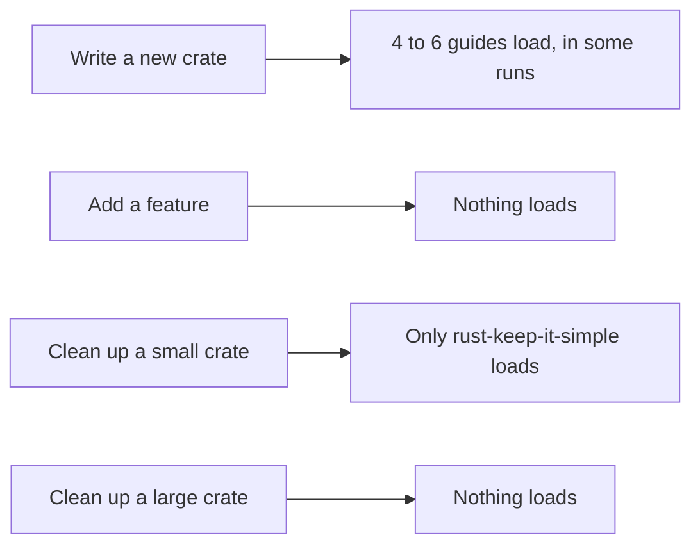
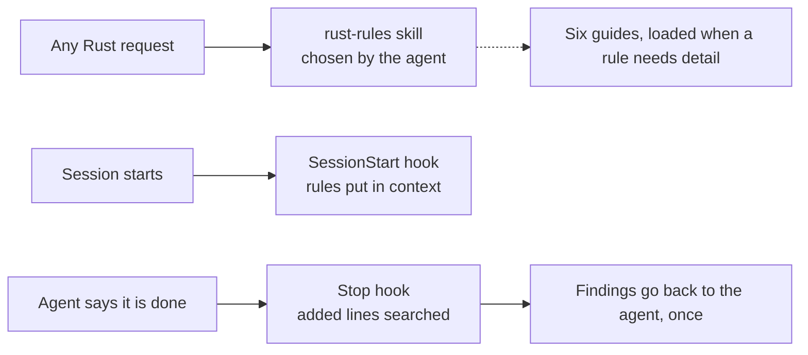

## What does this PR do?

Depends on #2.

Adds the Rust rules in three pieces:

- six guide skills, one per area: types, errors, ownership, simplicity, comments, tests;
- `rust-rules`, a short entry skill with one line per rule and a section on how far the rules reach on existing code;
- two shell hooks: at session start the agent is given the rules, and when it stops, the Rust lines the session added are searched for a few of them and the findings handed back.

The entry skill and the hooks exist because, in a trial with headless agents, the six guides on their own almost never got loaded. The rest of this description is that trial: what improved, by how much, and what it costs. The rows named "this PR" are runs with the files of this branch.

## How the rules reach the agent

Before, with the six guides only. The agent picks skills once, at the start, by matching the request against the descriptions:

With this PR there are three entry points, and two of them do not depend on the agent choosing:

## 1. Do the rules get loaded?

Runs in which the skill was loaded. Sonnet, headless.

| What is installed | New crate | Add a feature | Refactor |
|---|---|---|---|
| Six guides, as written | 4 of 6, then 0 of 3 | 0 of 6 | `rust-keep-it-simple` only, 6 of 6 |
| Six guides, descriptions reworded (5 wordings) | 0 of 15 | 0 of 15 | 1 of 15 |
| This PR: `rust-rules` entry skill | 9 of 9 | 9 of 9 | 9 of 9 |
| This PR: session-start hook | every session | every session | every session |

- **Six guides, as written.** The descriptions name things that happen in the middle of the work ("when defining structs", "reaches for `unwrap`"). A request like "add this feature" matches none of them. The one case where they loaded by themselves (new crate) did not repeat three days later with the same client.
- **Reworded descriptions.** Five wordings, one following the published guidance for skill descriptions. One load in 45 short runs. Wording is not the problem; the level of the description is.
- **Entry skill.** Its description restates the request ("Write, change or refactor Rust code"), so it matches whatever the task is. It was the first or second tool call in all 27 runs.
- **Hook.** Does not go through the agent's choice at all. It also runs in sessions that never touch Rust, which is its cost: about 90 lines of context per session.

## 2. Does the code get better?

Blind review by other model sessions that do not know which run had the rules. Each crate gets 0 to 4 per dimension and the table shows the sum, with the three runs in brackets. New crate: types, errors, simplicity, tests (16). Refactor: types, errors, simplicity (12). Feature: types, errors, tests of the code added (12).

| Delivery | New crate (of 16) | Refactor (of 12, start crate 4) | Add a feature (of 12, start crate 9) |
|---|---|---|---|
| No rules | 5.3 (5, 4, 7) | 5.0 (5, 5, 5) | 5.7 (6, 5, 6) |
| Checklist as a skill, no hooks | 11.7 (13, 10, 12) | 6.7 (6, 6, 8) | 8.3 (7, 11, 7) |
| Checklist by hooks, no skill (earlier variant, with clippy) | 12.3 (13, 11, 13) | 8.0 (9, 9, 6) | 10.3 (10, 10, 11) |
| This PR (skill + hooks) | 12.7 (13, 13, 12) | 7.0 (8, 7, 6) | 10.3 (11, 11, 9) |

- **New crate.** The largest effect: the score more than doubles and no run with rules overlaps a run without. The skill alone gets most of it. The hooks add mainly on tests (3.7 against 3.0 of 4).
- **Refactor.** The smallest and least steady effect. This PR is above no rules in every run, but by one to three points. An earlier round of the same skill with a slightly different stop message scored 10, 8, 8, so the spread between rounds is as large as the gap between deliveries.
- **Add a feature.** Without rules the new code is worse than the crate it is added to (5.7 against 9). With this PR it is slightly better (10.3). The skill alone gets part of the way and is uneven (7, 11, 7); the stop hook is what makes it steady.
- **Reviewers.** 80 of 81 scores repeated from earlier reviews of the same crates are within one point, 52 identical.

## 3. What changes in the code

Counted on the diff, three runs per row. Every run passes the acceptance tests the agent never sees (58 of 58, or 80 of 80 with the feature), so none of this cost behavior.

Adding a feature:

| Delivery | New `expect` in added code | Existing lines removed |
|---|---|---|
| No rules | 7, 8, 9 | 5, 1, 97 |
| Checklist as a skill, no hooks | 6, 6, 9 | 3, 6, 8 |
| Hooks with a soft stop message | 9, 12, 9 | 13, 9, 6 |
| This PR | 0, 0, 0 | 12, 5, 13 |

- **New `expect`.** With a soft message ("fix it or say why it stays") the agent got 31 to 41 findings, fixed one or two and kept the rest because "the existing handlers use the same pattern". The message here says that is not a reason. With that wording, 9 of 9 runs over three rounds add 0 or 1.
- **Existing lines removed.** The fix is small: the agent adds `required_*` getters to the existing parameter type and uses them in the new code. It does not rewrite the handlers that were already there.
- **Not confirmed blind.** In an earlier set, runs with and without the `expect` removal got the same score on the errors dimension (3 of 4). The change is real in the diff; the trial does not show that a reviewer values it.

Refactoring (start crate: 12.3 `expect` per thousand lines, 20 weak assertions):

| Delivery | `expect` per thousand lines | Weak assertions |
|---|---|---|
| No rules | 12.1, 12.0, 11.9 | 20, 20, 20 |
| Checklist as a skill, no hooks | 12.9, 11.9, 1.9 | 20, 20, 20 |
| This PR | 13.0, 0.9, 11.4 | 20, 15, 15 |
| This PR, earlier round | 2.6, 1.0, 2.8 | 15, 15, 15 |

- **Uneven.** Over the two rounds the agent removed the `expect` calls in 4 of 6 runs. In the other two it kept them and argued that typed getters would change which error the spec reports first. Three runs per round are not enough to tell the two stop messages apart.
- **What the scope section does.** The first version of the skill told the agent not to migrate existing code, a rule meant for features. Its three refactor runs left `expect` at 11.6 to 11.8. The skill now says the rules cover the whole requested scope when the request is a clean-up.

## 4. What it costs

Means of three runs, with the ratio against no rules on the same task. Tokens processed is everything the model read plus what it wrote; the conversation is read again at every turn, mostly from cache. Tokens written is the output alone.

| Task | Delivery | Time | Tokens processed | Tokens written |
|---|---|---|---|---|
| New crate | No rules | 5.7 min | 1.29M | 53k |
| | Checklist as a skill, no hooks | 7.4 min (1.28x) | 1.78M (1.38x) | 68k (1.27x) |
| | This PR (skill + hooks) | 9.8 min (1.71x) | 2.51M (1.94x) | 83k (1.55x) |
| Refactor | No rules | 1.2 min | 0.46M | 7k |
| | Checklist as a skill, no hooks | 1.6 min (1.38x) | 0.76M (1.65x) | 9k (1.40x) |
| | This PR (skill + hooks) | 3.0 min (2.51x) | 1.26M (2.74x) | 15k (2.25x) |
| Add a feature | No rules | 2.3 min | 0.84M | 18k |
| | Checklist as a skill, no hooks | 2.5 min (1.08x) | 0.94M (1.12x) | 19k (1.05x) |
| | This PR (skill + hooks) | 4.0 min (1.76x) | 1.61M (1.92x) | 26k (1.42x) |

- **Time.** A new crate takes four more minutes. A feature takes under two more, which is the round of fixes after the stop hook. The refactor has the largest ratio because the run without rules does almost nothing (one minute, 7k tokens written); in absolute terms it is two more minutes.
- **Tokens processed.** About double on a new crate and on a feature. This number follows the number of turns (18 to 26 on a new crate, 14 to 24 on a feature), because every turn reads the conversation again.
- **Tokens written.** 55% more on a new crate: the runs with rules write up to a third more code than the 2,100 lines without, with two to three times as many structs. 42% more on a feature.
- **Where the cost comes from.** Almost none of it is reading the rules: they are about 90 lines, read once. It comes from the agent doing more work once it knows them: more types, more tests, more review rounds. More work is more turns, and every turn costs tokens.
- **The cheaper option.** The skill without hooks adds 8% to 38% in time and 12% to 65% in tokens processed. It gets most of the gain on a new crate, less on a feature.
- **Spread.** Single runs vary. With this PR a new crate took 8 to 11 minutes and 1.7M to 3.1M tokens.

## Limits

- Three runs per cell, one kind of task (a small queue service), Sonnet, and model reviewers only. These are observations from a pilot: they show direction, not how much better.
- The stop hook searches for a few rules with regular expressions: panics, casts, strings used as ids, dropped results, untyped errors, weak assertions. It has nothing for ownership, simplicity or comments, and it flags lines that are fine. The agent may keep a finding and say why.
- The runs used Claude Code with the same scripts wired as a plugin. Through Symposium the hooks were checked by hand with 0.7.0 (`plugin validate`, `hook claude session-start`, `hook claude stop`), not with full runs, and not on other agents.

Take into account:
- The hooks are shell scripts and need `sh` and `git`. The stop hook only runs on agents with a stop event (Claude Code, Codex CLI, Antigravity).
- A finding is reported once per session and a session gets at most three reports. Session files live under `~/.local/state/just-right-rust` and are removed after a week.
- `hooks/test.sh` covers the cases that are easy to get wrong: uncommitted changes at session start, a repository with no commits, unit tests inside `src/`.

Disclosure questions

**AI disclosure.**

* The AI tool authored large parts of the code

