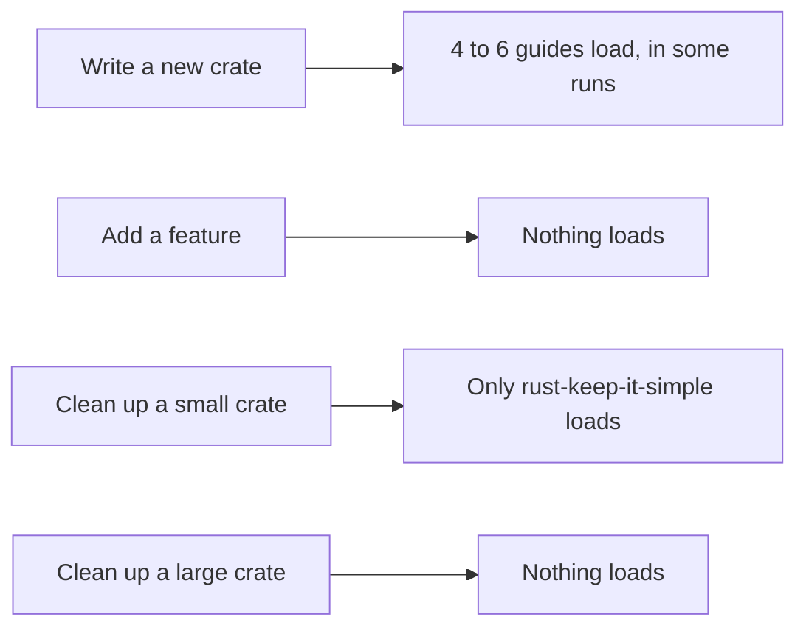
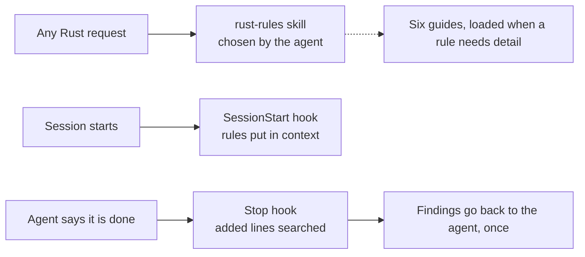

Title: feat: add a rules entry skill, six guides and two hooks

## What does this PR do?

Depends on #2.

Adds the Rust rules in three pieces:

- six guide skills, one per area: types, errors, ownership, simplicity, comments, tests;
- `rust-rules`, a short entry skill with one line per rule and a section on how far the rules reach on existing code;
- two shell hooks: at session start the agent is given the rules, and when it stops, the Rust lines the session added are searched for a few of them and the findings handed back.

The entry skill and the hooks exist because, in a trial with headless agents, the six guides on their own almost never got loaded. The rest of this description is that trial: what improved, by how much, and what it costs.

## How the rules reach the agent

Before, with the six guides only. The agent picks skills once, at the start, by matching the request against the descriptions:

With this PR there are three entry points, and two of them do not depend on the agent choosing:

## 1. Do the rules get loaded?

Runs in which the skill was loaded, Sonnet, headless.

| What is installed | New crate | Add a feature | Refactor |
|---|---|---|---|
| Six guides, as written | 4 of 6, then 0 of 3 | 0 of 6 | `rust-keep-it-simple` only, 6 of 6 |
| Six guides, descriptions reworded (5 wordings) | 0 of 15 | 0 of 15 | 1 of 15 |
| `rust-rules` entry skill | PENDING | PENDING | PENDING |
| Session-start hook | every session | every session | every session |

- **Six guides, as written.** The descriptions name things that happen in the middle of the work ("when defining structs", "reaches for `unwrap`"). A request like "add this feature" matches none of them. The one case where they loaded by themselves (new crate) did not repeat three days later with the same client.
- **Reworded descriptions.** Five wordings, one following the published guidance for skill descriptions. One load in 45 short runs. Wording is not the problem; the level of the description is.
- **Entry skill.** Its description restates the request ("Write, change or refactor Rust code"), so it matches whatever the task is.
- **Hook.** Does not go through the agent's choice at all. It also runs in sessions that never touch Rust, which is its cost: about 90 lines of context per session.

## 2. Does the code get better?

Blind review by other model sessions that do not know which run had the rules. Each crate gets 0 to 4 per dimension; the table is the sum. New crate: types, errors, simplicity, tests (16). Refactor: types, errors, simplicity (12). Feature: types, errors, tests on the code added (12). Three runs per cell.

| Delivery | New crate (of 16) | Refactor (of 12, start crate 5) | Add a feature (of 12, start crate 8) |
|---|---|---|---|
| No rules | 6.3 | 5.0 | 7.0 |
| Checklist as a skill only | 12.7 | 7.3 | 9.3 |
| Checklist by hook, earlier variant | 13.0 | 9.0 | 9.0 |
| This PR (skill + hooks) | PENDING | PENDING | PENDING |

- **New crate.** The largest effect. Any way of putting the checklist in front of the agent roughly doubles the score, and the skill alone gets almost all of it.
- **Refactor.** The skill alone moves it a little. What moves it more is telling the agent to go and look: the first version of this branch told it not to migrate existing code (a rule meant for features) and its refactor runs left `expect` where it was. The entry skill now separates the two cases. PENDING: numbers for the corrected text.
- **Add a feature.** The hardest case. New code copies the style around it, and for a long time nothing moved it. Two things did: a scope note ("lines you add follow the rules even where the code next to them does not; change existing code just enough") moved types, and the stop hook moved tests.

## 3. What changes in the code when adding a feature

Counted on the diff against the start crate. Three runs per row.

| Delivery | New `expect` in added code | Existing lines removed | Hidden tests |
|---|---|---|---|
| No rules | 7, 8, 9 | 5, 1, 97 | 80 of 80 |
| Checklist as a skill only | 6, 6, 9 | 3, 6, 8 | 80 of 80 |
| Hook with a soft message | 9, 12, 9 | 13, 9, 6 | 80 of 80 |
| Hook with the message in this PR | 1, 0, 0 | 14, 2, 3 | 80 of 80 |
| This PR (skill + hooks) | PENDING | PENDING | PENDING |

- **New `expect`.** With a soft message ("fix it or say why it stays") the agent got 31 to 41 findings, fixed one or two and kept the rest because "the existing handlers use the same pattern". The message in this PR says that is not a reason, and the agent then removes them.
- **Existing lines removed.** The fix is small: the agent adds `required_*` getters to the existing parameter type and uses them in the new code. It does not rewrite the handlers that were already there.
- **Hidden tests.** Every run still passes the acceptance tests the agent never sees, so none of this cost behavior.
- **Not confirmed blind.** The reviewer of the errors dimension gave the same score with and without the `expect` removal. The change is real in the diff; the trial does not show that a reviewer values it.

## 4. What it costs

Means of three runs. The ratio is against no rules on the same task.

| Delivery | New crate | Refactor | Add a feature |
|---|---|---|---|
| No rules | 18 turns, 5.7 min, USD 0.94 | 9 turns, 1.2 min, USD 0.25 | 14 turns, 2.3 min, USD 0.49 |
| Checklist as a skill only | 22 turns, 7.4 min, 1.27x | 15 turns, 1.6 min, 1.31x | 17 turns, 2.5 min, 1.06x |
| Checklist by hook, earlier variant | 24 turns, 10.1 min, 1.68x | 25 turns, 4.5 min, 2.70x | 22 turns, 4.5 min, 1.42x |
| This PR (skill + hooks) | PENDING | PENDING | PENDING |

- **Where the cost comes from.** Almost none of it is reading the rules: they are about 90 lines, read once. It comes from the agent doing more work once it knows them: more types, more tests, more review rounds. More work is more turns, and every turn costs tokens.
- **New crate.** 27% to 68% more. The runs with rules write 2,250 to 2,700 lines against 2,100, with two to three times as many structs.
- **Refactor.** The ratio looks large because the run without rules does almost nothing (9 turns, 1 minute). A refactor that changes the code costs USD 0.40 to 0.70 on this crate.
- **Add a feature.** The stop hook adds a round of fixes: about two more minutes and 40% more tokens.
- **Time.** Wall time depends on the API that day, so turns are the steadier number.

## Limits

- Three runs per cell, one kind of task (a small queue service), Sonnet for most runs, and model reviewers only. These are observations from a pilot, not a measurement of how much better.
- The stop hook searches for a few rules with regular expressions: panics, casts, strings used as ids, dropped results, untyped errors, weak assertions. It has nothing for ownership, simplicity or comments. Each finding names its exception, and the agent may keep it and say why.
- The hooks measured in most of the trial were Claude Code plugin hooks with clippy. The ones here run through Symposium, which gives a hook 5 seconds, so there is no clippy. PENDING: runs with the files of this branch.

Take into account:
- The hooks are shell scripts and need `sh` and `git`. The stop hook only runs on agents with a stop event (Claude Code, Codex CLI, Antigravity).
- A finding is reported once per session and a session gets at most three reports.
- `hooks/test.sh` covers the cases that are easy to get wrong: uncommitted changes at session start, a repository with no commits, unit tests inside `src/`.

Disclosure questions

**AI disclosure.**

* The AI tool authored large parts of the code

